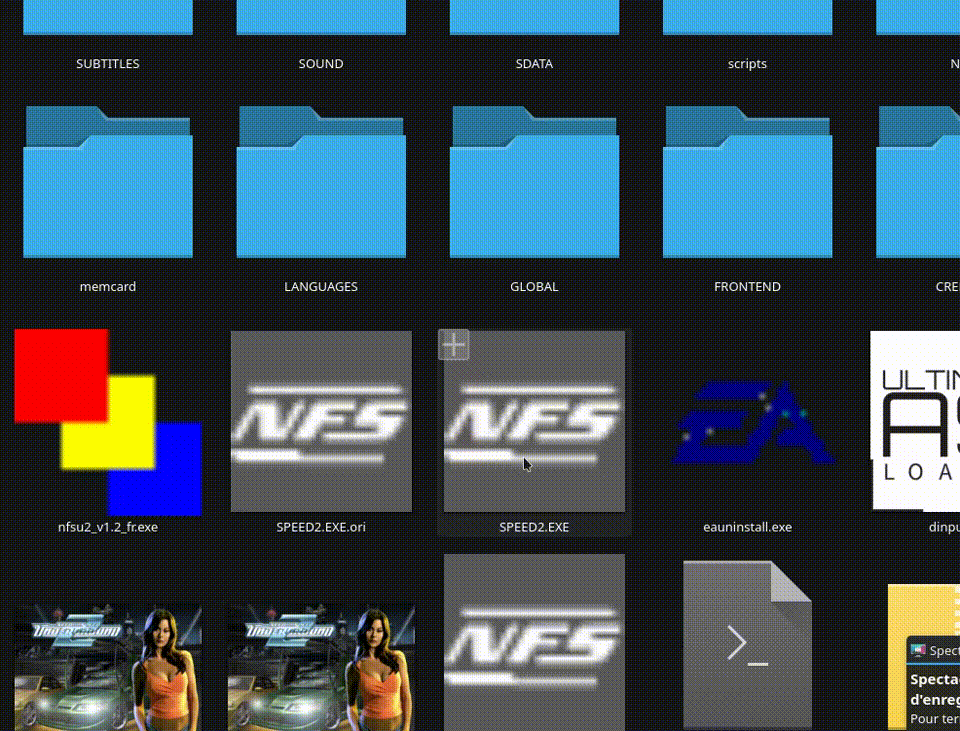

# 🧩 Proton-Autogen


**Proton-autogen automatically creates and configures Proton environments for Windows games and applications, applying optimized settings for the best compatibility.**

**Proton-autogen is a lightweight Proton/Wine orchestration layer that allows Linux users to run Windows applications from `.exe` files without manually managing Steam shortcuts or Wine prefixes.**


Run Windows executables through Proton with zero Steam configuration.
---
🎬 Quick Demo
<p align="left">
  
</p>

## ✨ Why Proton-Autogen?

**Run Windows applications on Linux with less setup and fewer manual steps.**

* 🚀 **One-Click Launching** — Launch Windows .exe files directly from your file manager.
* 🔍 **Automatic Runtime Detection** — Automatically detect available Proton installations and simplify runtime selection.
* 🎮 **Proton & Wine Support** — Launch Windows applications using Proton or Wine, depending on your configuration.
* 🖥️ **Desktop Integration** — Seamlessly integrate with Nemo, Nautilus, and Dolphin for a smoother Linux desktop experience.
* ⚙️ **Custom Launch Profiles** — Configure and manage application-specific launch settings.
* 🛠️ **Built-in Diagnostics** — Generate diagnostic reports to help troubleshoot launch issues.
* 🪄 **Less Manual Configuration** — Automate repetitive setup tasks and spend less time configuring your environment.
* 🐧 **Linux-Native Experience** — Bring Windows application launching into your existing Linux workflow.

**The goal: make launching Windows applications on Linux as simple and convenient as possible.**

## 🚀 Overview

Proton-Autogen automatically detects available Proton installations, configures the required runtime environment, and launches Windows applications using Proton with Wine fallback support.

No manual Steam shortcut creation or prefix configuration is required.

Simply:

* Right-click a `.exe`
* Select **Open with Proton-Autogen**
* Launch the application

---

## ✨ Features

See an example of generated profiles here: [Profile Output Example](docs/profiles.md)
See more info: [Features](docs/features.md)
---

### Integration
Right-click any Windows executable and select:

```text
Open with Proton-Autogen
```

---

## 🧪 Usage

### Terminal

```bash
proton-autogen game.exe
```

### Graphical interface:

```bash
proton-autogen --ux
```

## 🛠️ Troubleshooting

If an application does not launch, generate a diagnostic report:

```bash
proton-autogen --diag
```
### Example Output:
See the full example output here: [Example Output](docs/examples.md)


---
## 📦 Downloads

Latest releases are available on GitHub:

- Debian / Ubuntu: `.deb` package
- Source installation: `install.sh`
- Arch Linux / CachyOS: AUR


## 📦 Installation & Updates

### 📦 **Arch Linux / CachyOS users:** Proton-Autogen is now available on the AUR.

Install it with:

 ```bash
 paru -S proton-autogen
 ```


### Ubuntu / Linux Mint / Pop!_OS (Recommended)

The recommended installation method is the official Proton-Autogen PPA:

Until then, the manual installer is available.

### Recommended installation (Ubuntu / Linux Mint / Pop!_OS)

```bash
sudo add-apt-repository ppa:n3oray/proton-autogen
sudo apt update
sudo apt install proton-autogen
```

### Debian / Ubuntu-based distributions (.deb package)

Download the latest `.deb` release from GitHub:
```bash
sudo apt install ./proton-autogen_*.deb
```
### Build Debian package manually

```bash
git clone https://github.com/N3oRay/proton-autogen.git
cd proton-autogen
dpkg-buildpackage -b -us -uc
sudo apt install ../proton-autogen_*.deb
```

### See the manual :
#### Installation guide:
[Install Guide](docs/install.md)

#### Uninstallation guide:
[Uninstall Guide](docs/uninstall.md)


Review the installer before running it
```bash
less install.sh
```
### Install manual  (Arch,Endeavouros,Cachyos,Garuda,Manjaro,Arcolinux,Rebornos,Debian,Ubuntu,Linuxmint,Pop,Elementary,Zorin,Fedora,Nobara)
```bash
git clone https://github.com/N3oRay/proton-autogen.git
cd proton-autogen
chmod +x install.sh
./install.sh
```
This installs:

* `/usr/bin/proton-autogen`
* Integrated with Nemo (Cinnamon), Nautilus (GNOME), and Dolphin (KDE Plasma).


## Flatpak

Proton-Autogen is also available as a Flatpak.

For installation from source, see:

[Flatpak installation guide](INSTALL_FLATPAK.md)


### Config
The configuration is fully automatic.
```bash
cat ~/.config/proton-autogen/proton-autogen.conf
ls ~/.config/proton-autogen/games
```

---

## ⚠️ Requirements

### Required

* Python 3.x
* A working Proton installation

Supported locations:

```text
~/.steam/root/compatibilitytools.d
~/.steam/debian-installation/compatibilitytools.d
~/.local/share/Steam/compatibilitytools.d
```

### Optional

- GameMode - MangoHud - GameScope
- Proton-CachyOS / GE-Proton
- ProtonUp-Qt
  
```bash
sudo apt install gamemode mangohud
```
---

## 🧠 How It Works

1. Detect available Proton installations
2. Prefer GE-Proton when available
3. Launch executable through Proton
4. Fall back to Wine if Proton runtime tools are unavailable
5. Optionally enable GameMode

No Steam shortcut creation is required.

---


## 🚧 Known Limitations

* Not every Windows application works under Proton
* Some launchers require additional configuration
* Proton compatibility depends on the selected Proton version
* Certain applications may still require Wine tweaks

---

## 🛣️ Roadmap
[Roadmap Docs](docs/roadmap.md)

---

## 🤝 Contributing

Bug reports, feature requests, and contributions are welcome.

Please use GitHub Issues for discussions and reports.


## 💡 Philosophy

Linux gaming is powerful but often fragmented.

Proton-Autogen aims to reduce friction by turning Proton into a transparent execution layer rather than a manually configured tool.

The goal is simple:

> Right-click → Run Windows application → It just works.

---

## 👤 Author

**N3oray**


GitHub: [@N3oRay](https://github.com/N3oRay)

---

## 📜 License

This project is licensed under the MIT License.

See the `LICENSE` file for details.


## 📈 Project Activity

[Activity info](docs/activity.md)

## ❤️ Support Proton-Autogen

Proton-Autogen is free and open source. Your support helps me continue development, improve compatibility, and maintain the project.

☕  [Support me on Ko-fi](https://ko-fi.com/n3oray)

Thank you! ❤️
